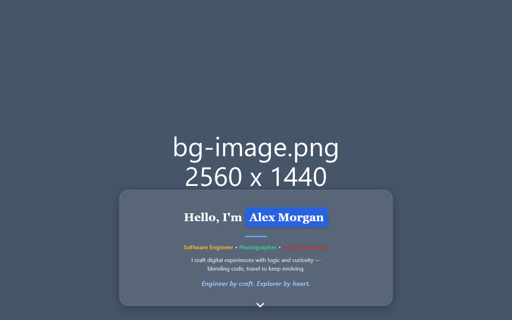
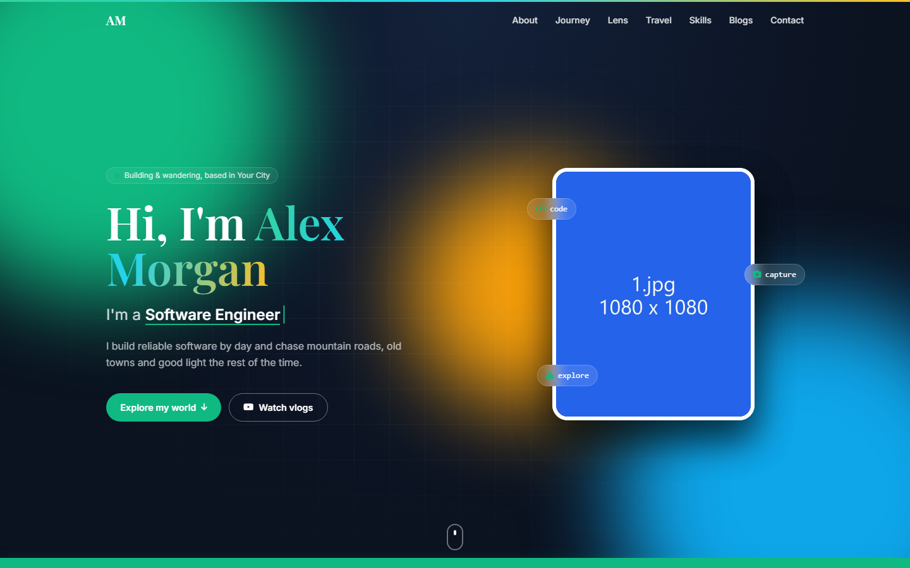
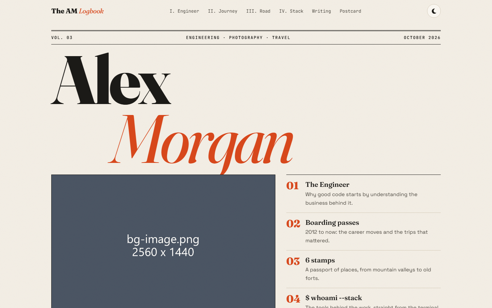
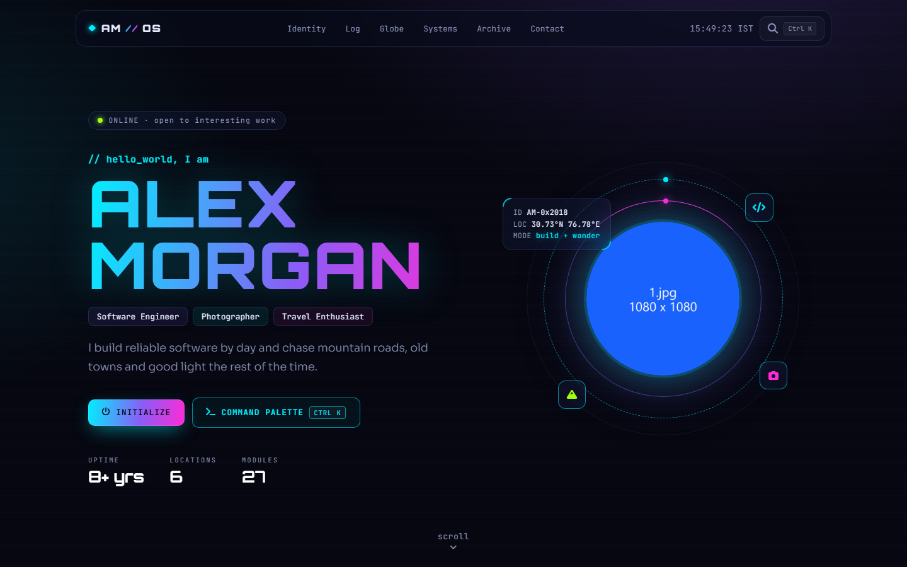
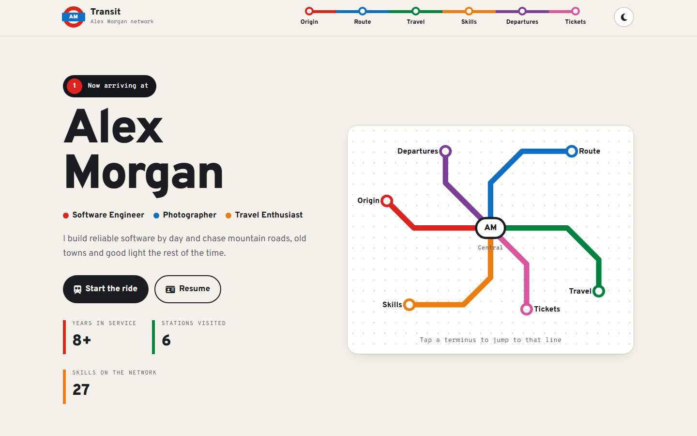
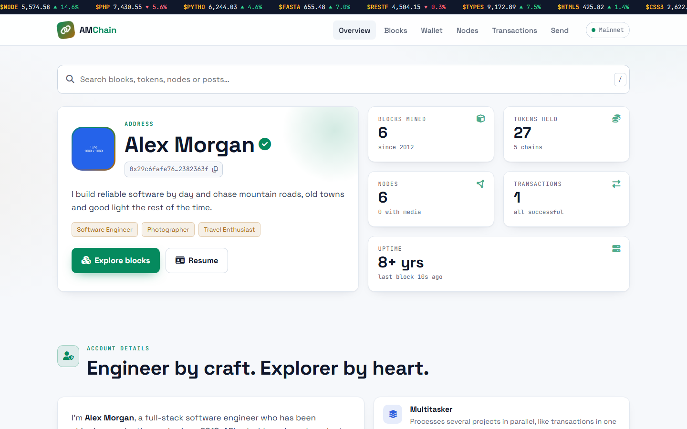
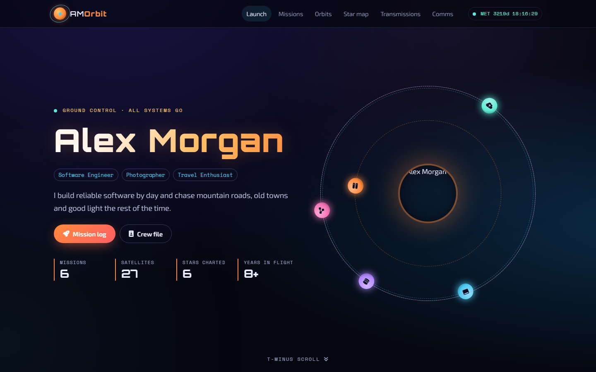

# Portfolio Template

A personal portfolio and blog in plain PHP, with seven different designs that share one set of content. No framework, no build step, no database.

| Version | Style |
|---|---|
| `1/` Classic | Tailwind portfolio |
| `2/` Dark gradient | Photo stack, typer, polaroids |
| `3/` The Logbook | Editorial, magazine style |
| `4/` DEV//OS | Neon terminal |
| `5/` Transit Map | Metro map, departures board |
| `6/` Chain | Blockchain explorer, wallet, node map |
| `7/` Orbit | Space mission control, orrery, star map |

You can run one version on its own, or let the root `.htaccess` rotate between them.

## Screenshots

| | |
|---|---|
| **1 · Classic**  | **2 · Dark gradient**  |
| **3 · The Logbook**  | **4 · DEV//OS**  |
| **5 · Transit Map**  | **6 · Chain**  |
| **7 · Orbit**  | |

The photos in the screenshots are the included placeholders. Swap in your own under `shared/assets/imgs/`.

## Requirements

- PHP 8.1 or newer
- Apache with `mod_rewrite` (XAMPP, cPanel hosting, etc.)

## Quick start

1. Copy the folder into your web root, for example `htdocs/portfolio-template`.
2. Copy `shared/.env.example` to `shared/.env` and set `SITE_URL`.
3. Open `http://localhost/portfolio-template/versions.php` to preview every version (only works from localhost).

## Make it yours

Everything personal lives in `shared/`:

| File | What it holds |
|---|---|
| `shared/app/data/profile.php` | Name, initials, photo, bio, links, resume details |
| `shared/app/data/journey.php` | Timeline of work, study and travel |
| `shared/app/data/skills.php` | Skill groups |
| `shared/app/data/socials.php` | Social links in the footer |
| `shared/app/data/vlogs.php` | YouTube videos |
| `shared/app/data/places.php` | Pins on the travel map |
| `shared/app/data/blogs.php` | Blog post list |
| `shared/content/blogs/*.html` | Blog post bodies |
| `shared/assets/imgs/` | Photos, banner, favicon (the ones included are placeholders) |

Your name and initials come from `profile.php`, so the headers, footers, page titles and structured data all update from that one file. A version can override parts of a data file with its own `N/app/data/{name}.php`.

The privacy page in each version (`N/app/views/pages/privacy.php`) is a generic example. Read it and change it to match how you actually run your site.

## Choosing which version is live

The root `.htaccess` picks a version for each request. Edit the rules there to always serve one version, or to rotate them on whatever schedule you like. Each version folder also works on its own as a document root.

## Contact form

The contact form sends messages to Telegram. Set `TELEGRAM_BOT_TOKEN` and `TELEGRAM_CHAT_ID` in `shared/.env`. Without them the form shows an error and logs a warning.

## Analytics

Set `GA_ID` in `shared/.env` to turn on Google Analytics. It stays off when `APP_ENV=local`.

Each version folder has its own README with more detail on its layout.
